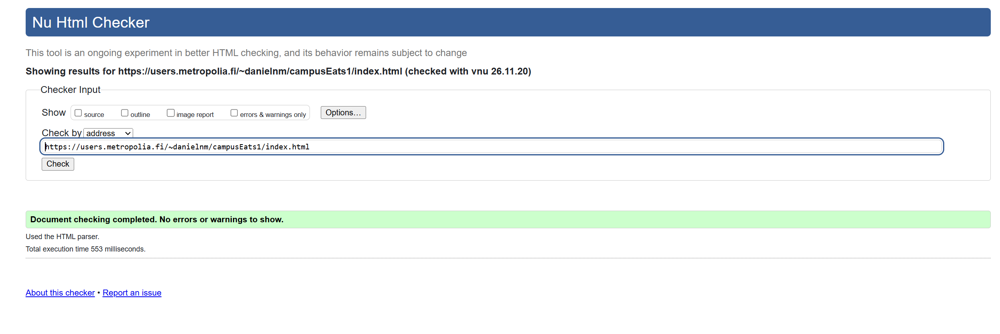
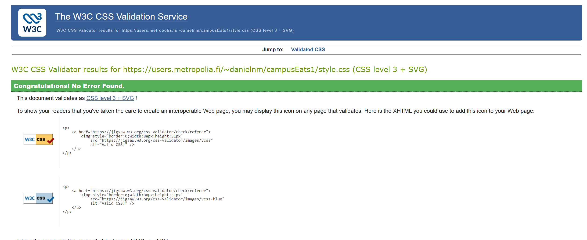
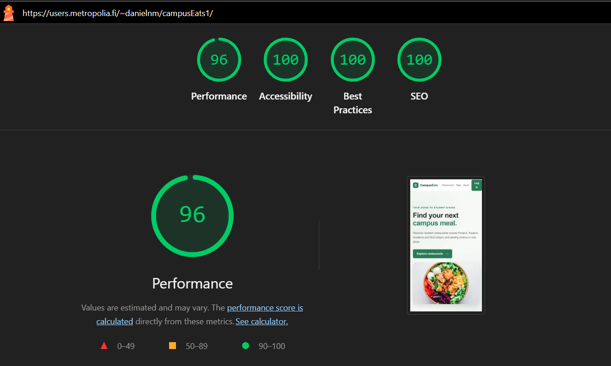

# CampusEats — Finnish Student Restaurant Guide

**CampusEats** is a responsive web application built with vanilla HTML5, CSS3, and ES6+ JavaScript for discovering Finnish student restaurants, viewing their locations on an interactive map, and browsing daily and weekly menus.

- **Live Application:** [https://users.metropolia.fi/~danielnm/campusEats1/](https://users.metropolia.fi/~danielnm/campusEats1/)
- **Course:** TX00EY23 Web-sovelluskehitys (Individual Assignment)

---

## Features Implemented

### Core & Directory Features
- **Restaurant Directory:** Fetches and displays student restaurants across Finland from the Metropolia Student Restaurant REST API (`GET /restaurants`).
- **Search, Filter & Sort:** Real-time search by restaurant name or city, dynamic city filter dropdown (`#city-filter`), and sorting by name (`A–Z` / `Z–A`) or proximity (`Nearest to me`).
- **Daily & Weekly Menus:** Interactive tab switcher (`Daily menu` / `Weekly menu`) fetching `/restaurants/daily/:id/en` and `/restaurants/weekly/:id/en` with course names, dietary tags, and student prices.

### Map & Geolocation
- **Interactive Leaflet Map:** Displays all filtered restaurants on an OpenStreetMap-powered Leaflet map with custom DOM-built popups and two-way synchronization between map markers and directory cards.
- **Nearest Restaurant Highlighting:** Uses the browser Geolocation API (`navigator.geolocation`) and Leaflet's `L.latLng().distanceTo()` helper to place a user location marker, calculate distances in kilometers, display distance badges on cards and popups, highlight the closest restaurant, and automatically open its menu.

### User Authentication & Account Management
- **Login & Registration:** Accessible modal (`<dialog>`) supporting account creation (`POST /users`) and login (`POST /auth/login`) with JWT token persistence in `localStorage`.
- **Favorite Restaurant:** Authenticated users can mark/unmark a favorite restaurant (`PUT /users`), highlighting it and pinning it to the top of the restaurant list in alphabetical sort modes.
- **Profile Picture Upload:** Users can upload a custom avatar image (`POST /users/avatar` using `FormData`), updating both the navigation badge and profile dialog.
- **Update Account Details:** Dedicated edit modal allowing logged-in users to update their `username`, `email`, and optional `password` (`PUT /users`).

---

## Project Structure & Architecture

- `index.html` — Semantic HTML5 layout, ARIA landmarks, and native `<dialog>` modals
- `style.css` — Custom responsive CSS3 (Grid, Flexbox, CSS variables, zero frameworks)
- `t5.js` — Modular ES6+ application logic, API client, Leaflet map, and auth state
- `README.md` — Project documentation and verification evidence
- `screenshots/` — W3C validation and Google Lighthouse audit screenshots

### How the Application Works (`t5.js`)
1. **Centralized API Helper (`fetchData`):** Wraps `fetch()` with consistent HTTP error handling and JSON parsing so network or validation errors from the backend surface cleanly in the UI.
2. **State-Driven Rendering:** Stores `restaurants`, `activeRestaurant`, `activeMenuType`, `userCoords`, `authToken`, and `currentUser` in memory, re-rendering filtered cards (`filterAndRenderRestaurants`) and map pins (`updateMapMarkers`) whenever filters or user state change.
3. **Session Restoration (`checkSavedSession`):** On page load, checks `localStorage` for a saved JWT token and validates it against `GET /users/token` so logged-in sessions persist across page refreshes.
4. **Menu Rendering & Race-Condition Guard (`loadMenu` & `displayMenuData`):** Tracks outgoing requests with `menuRequestId` so stale responses never overwrite newer selections, and dynamically constructs DOM elements for daily and weekly courses.

---

## Validation & Performance Verification

- **W3C HTML Validation:** Passed with 0 errors and 0 warnings ([View W3C HTML Validation Result](https://validator.w3.org/nu/?doc=https%3A%2F%2Fusers.metropolia.fi%2F~danielnm%2FcampusEats1%2Findex.html)).
- **W3C CSS Validation:** Passed with 0 errors and 0 warnings ([View W3C CSS Validation Result](https://jigsaw.w3.org/css-validator/validator?uri=https%3A%2F%2Fusers.metropolia.fi%2F%7Edanielnm%2FcampusEats1%2Fstyle.css&profile=css3svg&usermedium=all&warning=1&vextwarning=&lang=en)).
- **Google Lighthouse Audit:**
  - **Performance:** 96 / 100
  - **Accessibility:** 100 / 100
  - **Best Practices:** 100 / 100
  - **SEO:** 100 / 100

### Validation & Performance Screenshots

**W3C HTML Validation**

**W3C CSS Validation**

**Google Lighthouse Audit**

---

## Manual Functional Test Checklist

| Test Case | Expected Behavior | Status |
| :--- | :--- | :--- |
| Load restaurants & menus | Restaurant list populates; clicking a card loads Daily/Weekly menus | Passed |
| Filter & sort | City dropdown and search input filter both the list and map markers | Passed |
| Geolocation ("Find nearest") | Places blue user pin, calculates distances in km, and selects nearest restaurant | Passed |
| Register & Log in | Creates account / authenticates via JWT and persists login on reload | Passed |
| Favorite restaurant | Toggles favorite status via `PUT /users` and pins restaurant to top | Passed |
| Upload avatar & edit profile | Uploads image via `POST /users/avatar` and updates credentials via `PUT /users` | Passed |

---

## Known API & Design Behavior
- **Weekly Menu Feed:** Weekly menus (`/restaurants/weekly/:id/en`) display all days and courses published by the catering provider in the backend feed. Because the API does not include separate daily opening-hours metadata, weekend entries (such as Saturday courses) are rendered whenever the provider includes them in the weekly feed.
- **Registration SMTP 535 Response:** During `POST /users`, the Metropolia API writes the new user record to the database before attempting to dispatch a confirmation email. When the server's SMTP relay fails with error `535`, the client catches this specific server behavior, switches to the login view, and prompts the user to log in.

---

## Future Improvements
- **Modular ES6 Architecture:** As the application scales, `t5.js` can be refactored into separate ES modules (`api.js`, `map.js`, `menus.js`, `auth.js`, `profile.js`, and `main.js`).